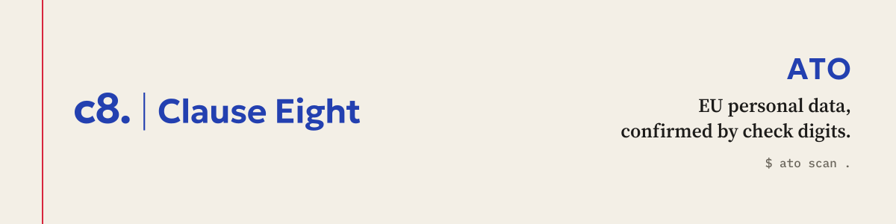

<picture>
  <source media="(prefers-color-scheme: dark)" srcset=".github/assets/ato-banner-dark.png">
  
</picture>

# ATO

Find EU personal data in code, test fixtures, logs and exports before it spreads. Every match is confirmed with the identifier's own rules (check digits, dates, lengths), so findings are few and real, and found values are never printed in reports.

Open source under the [Apache License 2.0](LICENSE). A [Clause Eight](https://clauseeight.eu) tool, called pii-eu before 2.0.

```text
$ ato scan .
app/config.yml
  3:17  high    Payment card number  ••••••••••••7892
          brand prefix, length and Luhn check are valid; the word "card" is nearby

tests/fixtures/users.json
  14:12  medium  Romanian personal number (CNP)  •••••••••••••
          date, county code and check digit are valid; the word "cnp" is nearby; in a test, fixture or example path

2 findings in 2 files · 1284 files scanned
```

## Install

```bash
go install github.com/Clause-Eight/ato/v2/cmd/ato@latest
```

Needs Go 1.24 or later. Other ways (from source, release binaries) and how to put `ato` on your `PATH`: [docs/INSTALL.md](docs/INSTALL.md).

## Quick start

```bash
ato scan                 # scan the current folder
ato scan path/to/repo    # or any folder
ato baseline             # accept what is there today; later scans report only new findings
ato fix --dry-run        # preview replacing real values in test fixtures with made-up ones
```

Exit code `0` means nothing was found, `1` means findings. Settings go in `.ato.toml` in the scanned folder.

## What it finds

- **National identifiers** for every EU country, plus EEA, Switzerland and the UK on request: personal numbers, tax IDs, social security and ID cards. [Coverage by country](docs/COVERAGE.md).
- **Financial data**: IBANs for every SEPA country, payment cards, EU VAT numbers.
- **Contact data**: email addresses and phone numbers.
- **Special categories** (GDPR Art. 9): health, genetic and biometric data in schemas, records and codes.
- **Where personal data goes**: log, error-tracker and analytics calls, Terraform data stores without encryption, retention or EU residency, and third-party services named in the code.

Every detector and how it confirms a match: [docs/DETECTORS.md](docs/DETECTORS.md).

## In CI

```yaml
- uses: actions/checkout@<sha>
- uses: Clause-Eight/ato@<sha>
```

Findings appear as annotations on the pull request. pre-commit, GitLab and Bitbucket: [docs/CI.md](docs/CI.md).

## Documentation

| Guide | What's in it |
|---|---|
| [Install](docs/INSTALL.md) | Go, source, release binaries, verifying downloads |
| [Usage](docs/USAGE.md) | Every command: scan, exports and archives, container images, inventory, data map, Terraform, logs, fix |
| [Configuration](docs/CONFIGURATION.md) | Flags, `.ato.toml`, exit codes, ignore comments, baselines |
| [CI and pre-commit](docs/CI.md) | GitHub Actions, pre-commit, GitLab, Bitbucket |
| [How it decides](docs/HOW-IT-WORKS.md) | Validation, confidence and masking |
| [Detectors](docs/DETECTORS.md) · [Coverage](docs/COVERAGE.md) | Every identifier, by country |
| [Benchmarks](docs/BENCHMARKS.md) | Compared with other scanners |
| [Compatibility](docs/COMPATIBILITY.md) · [Upgrading from pii-eu](docs/UPGRADING.md) | What stays stable in 2.x |

## Contributing

A new identifier is one detector file, a generator and its tests. See [CONTRIBUTING.md](CONTRIBUTING.md). Test data must be synthetic.

## Licence

Copyright 2026 Clause Eight. Licensed under the [Apache License 2.0](LICENSE); see also [NOTICE](NOTICE).
