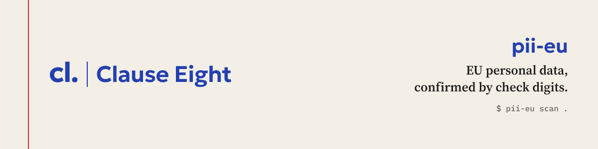

<picture>
  <source media="(prefers-color-scheme: dark)" srcset=".github/assets/pii-eu-banner-dark.png">
  
</picture>

# pii-eu

A Clause Eight tool. Proprietary: see [Licence](#licence).

Find EU personal data in code, test fixtures and logs before it spreads. Every match is confirmed with the identifier's own rules (check digits, dates, lengths), so findings are few and real, and found values are never printed in reports.

```text
$ pii-eu scan .
app/config.yml
  3:17  high    Payment card number  ••••••••••••7892
          brand prefix, length and Luhn check are valid; the word "card" is nearby

tests/fixtures/users.json
  14:12  medium  Romanian personal number (CNP)  •••••••••••••
          date, county code and check digit are valid; the word "cnp" is nearby; in a test, fixture or example path

2 findings in 2 files · 1284 files scanned
```

## What it finds

Romanian CNP, Bulgarian EGN and LNCh, Hungarian TAJ and tax ID, Polish PESEL, Czech and Slovak birth numbers, Croatian OIB, IBANs for every SEPA country, payment cards, EU VAT numbers (with check digits for RO, BG, HU, DE and PL), email addresses and RO, BG, HU and PL phone numbers. The full list, with how each match is confirmed, is in [docs/DETECTORS.md](docs/DETECTORS.md).

National identifiers by country:

<!-- coverage:start -->
| Country | Personal number | Tax ID | Social security or health | ID card or passport |
|---|---|---|---|---|
| AT | – | – | – | – |
| BE | – | – | – | – |
| BG | `bg-egn`, `bg-lnch` | – | – | – |
| CY | – | – | – | – |
| CZ | `cz-birth-number` | – | – | – |
| DE | – | `de-tax-id` | `de-pension` | `de-id-card` |
| DK | – | – | – | – |
| EE | – | – | – | – |
| ES | `es-dni`, `es-nie` | – | `es-nss` | – |
| FI | – | – | – | – |
| FR | – | `fr-spi` | `fr-nir` | – |
| GR | – | – | – | – |
| HR | `hr-oib` | – | – | – |
| HU | – | `hu-tax-id` | `hu-taj` | – |
| IE | – | – | – | – |
| IT | – | `it-fiscal-code` | – | – |
| LT | – | – | – | – |
| LU | – | – | – | – |
| LV | – | – | – | – |
| MT | – | – | – | – |
| NL | `nl-bsn` | – | – | – |
| PL | `pl-pesel` | – | – | – |
| PT | – | – | – | – |
| RO | `ro-cnp` | – | – | – |
| SE | – | – | – | – |
| SI | – | – | – | – |
| SK | `cz-birth-number` | – | – | – |
| CH | – | – | – | – |
| GB | – | – | – | – |
| IS | – | – | – | – |
| LI | – | – | – | – |
| NO | – | – | – | – |

* off by default; on when the country is selected with `--countries`. IBANs, cards, VAT numbers, contact data and the other cross-border detectors cover every country.
<!-- coverage:end -->

## Install

pii-eu is distributed to Clause Eight customers. With access to the repository:

```bash
export GOPRIVATE=github.com/Clause-Eight/*
go install github.com/Clause-Eight/pii-eu/cmd/pii-eu@latest
```

Binaries for Linux, macOS and Windows (amd64 and arm64) are attached to each release, with an SBOM per archive and a signed `checksums.txt`. To verify a download:

```bash
cosign verify-blob checksums.txt --bundle checksums.txt.sigstore.json \
  --certificate-identity-regexp '^https://github.com/Clause-Eight/pii-eu/\.github/workflows/release\.yml@refs/tags/v' \
  --certificate-oidc-issuer https://token.actions.githubusercontent.com
sha256sum --ignore-missing -c checksums.txt
```

## Use

```bash
pii-eu scan                       # the current folder
pii-eu scan --format json --output pii-eu.json path/to/repo
pii-eu scan --staged .            # staged changes only, for pre-commit
kubectl logs deploy/api | pii-eu scan -     # a log stream
pii-eu baseline                   # accept what is there today; report only new findings
```

| Flag | Meaning |
|---|---|
| `--format` | `text` (default), `json`, `sarif`, `github` (workflow annotations), `codequality` (GitLab) |
| `--output FILE` | write the report to a file |
| `--min-confidence` | `low`, `medium` (default) or `high` |
| `--countries` | only these countries' national detectors, as ISO codes or presets: `--countries ro,bg` or `--countries cee`. Cross-border detectors (IBAN, cards, VAT, contact data) always run |
| `--include`, `--exclude` | glob patterns; `**` crosses folders; repeatable |
| `--staged` | scan the staged version of staged files |
| `--baseline FILE` | baseline file (default `.pii-eu-baseline.json` in the scanned folder) |
| `--no-git` | walk the folder instead of asking git (inside a work tree, `.gitignore` is honoured) |
| `--show-values` | print found values on screen; never in JSON, SARIF or files |

Exit codes: `0` nothing found, `1` findings, `2` usage or settings error, `3` some files could not be read.

### Settings

`.pii-eu.toml` in the scanned folder:

```toml
include = ["src/**", "config/**"]
exclude = ["vendor", "**/*.min.js"]
min_confidence = "medium"
max_file_size = 5242880

countries = ["ro", "bg", "hu"]   # or presets: eu, eea, cee, dach, benelux, nordics, baltics

[detectors]
email = false        # switch a detector off

[min_confidence_per_detector]
eu-phone = "high"    # report phone numbers only when the evidence is strong
```

Presets: `eu` (the 27 member states, the default), `eea` (adds Iceland, Liechtenstein and Norway), `cee`, `dach`, `benelux`, `nordics` and `baltics`. Naming a country outside the EU, such as `ch` or `gb`, switches on its detectors, which are off by default. An unknown code is an error.

### Keeping a deliberate value

Put `pii-eu:ignore` and a reason on the same line or the line before. Without a reason the comment does not apply.

```python
SAMPLE_IBAN = "RO49AAAA1B31007593840000"  # pii-eu:ignore documented example from the bank's API guide
```

## In CI

**GitHub Actions**

```yaml
- uses: actions/checkout@<sha>
- uses: Clause-Eight/pii-eu@<sha>
  with:
    path: .
    sarif: pii-eu.sarif      # optional; upload it with github/codeql-action/upload-sarif
```

Findings appear as annotations on the pull request; the step fails on findings unless `fail-on-findings: "false"`.

**pre-commit**

```yaml
repos:
  - repo: https://github.com/Clause-Eight/pii-eu
    rev: <tag or sha>
    hooks:
      - id: pii-eu
```

**GitLab and Bitbucket**: [ci/gitlab/pii-eu.gitlab-ci.yml](ci/gitlab/pii-eu.gitlab-ci.yml) (Code Quality widget) and [ci/bitbucket/bitbucket-pipelines.yml](ci/bitbucket/bitbucket-pipelines.yml).

## How it decides

1. A cheap prefilter skips detectors that cannot match a line (too few digits, a missing literal), so scan time stays flat as detectors are added.
2. A pattern finds candidates; the characters around a candidate must not be letters or digits.
3. The validator checks the identifier's rules. Only valid values become findings.
4. Confidence starts at the detector's base. It rises one step when the value is written in the identifier's usual format (an IBAN in groups of four, a birth number with its slash) and one step when a keyword is on the line or the line before. Keywords come in all 24 EU languages and match without regard to case or diacritics. It drops one step in test, fixture and example paths, and is always low for published sample values (documentation IBANs, well-known test cards).
5. Overlapping matches keep the most confident one. A value that is valid for two detectors is reported once, preferring the detector whose own name is nearby, and the finding says what else it could be.
6. Reports show masked values. Fingerprints, used by baselines and SARIF, come from the detector, path and the line with values replaced, never from the value.

The JSON report follows [schemas/findings.schema.json](schemas/findings.schema.json).

## Adding detectors

A new identifier is one detector file, a generator and its tests. See [CONTRIBUTING.md](CONTRIBUTING.md). Test data must be synthetic.

## Licence

Copyright 2026 Clause Eight. All rights reserved. pii-eu is proprietary from version 0.3.0; see [LICENSE](LICENSE) and [NOTICE](NOTICE). Versions 0.2.0 and earlier were published under the Apache License 2.0, and copies of those versions keep that licence.
